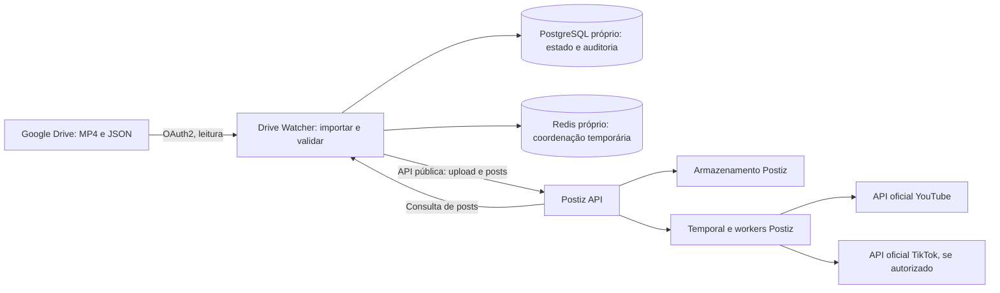

# Análise técnica: Google Drive → Postiz → TikTok e YouTube Shorts

> Documento da primeira entrega, preservado como referência de planejamento. Para o estado implementado e os comandos atuais, consulte o [README](../README.md).

Data: **14/11/2026**, referência de operação `America/Sao_Paulo`.

Entrega: análise e plano de implementação do **Drive Watcher**, sem código de aplicação, instalação de dependências, criação de credenciais ou implantação.

## 1. Parecer e limites desta análise

A API pública do Postiz oferece os recursos necessários para receber os vídeos, criar rascunhos e agendar publicações. A integração deve ser um serviço independente: o Watcher importa e acompanha os arquivos; o Postiz conserva a responsabilidade pelo calendário, pelos tokens das redes sociais, pelas filas de publicação e pela comunicação com as plataformas.

**A integração com o Drive é tecnicamente viável. A publicação pública e automática em todos os destinos ainda não está validada.** Um conector disponível no código ou uma conta listada pelo Postiz não comprovam autorização para publicar. As condições específicas de TikTok e YouTube e as diferenças entre seus conectores estão detalhadas na seção 6.

Foi analisado o repositório público [gitroomhq/postiz-app](https://github.com/gitroomhq/postiz-app), branch `main`, no commit **`132859f32d854830ce44b509da87409c3ec10a77`**, datado de 13/11/2026. Os links de código deste documento estão fixados nessa revisão. A consulta foi feita em uma cópia temporária, sem alterações no núcleo.

Não foram fornecidos URL de uma instância Postiz, versão instalada, chave de API, pasta do Drive, tokens, contas sociais ou aprovações dos aplicativos. Portanto, os endpoints foram verificados estaticamente no código e na documentação; não foram executadas chamadas autenticadas, uploads ou publicações. As propostas abaixo estão identificadas como decisões de projeto, e não como funcionalidades já entregues.

Premissas iniciais propostas: uma pasta, uma organização Postiz, um canal YouTube e um canal TikTok; dois vídeos por dia, cada vídeo destinado aos dois canais, às 08:00 e 20:00. Isso representa até quatro publicações sociais por dia. Subpastas, múltiplas contas e republicação intencional ficam para etapas posteriores.

## 2. Arquitetura identificada no Postiz

| Componente | Papel observado |
| --- | --- |
| Monorepositório TypeScript, pnpm | Aplicações em `apps/` e serviços compartilhados em `libraries/`. |
| `apps/frontend` | Interface Next.js: conexão dos canais, biblioteca de mídia, composição e calendário. |
| `apps/backend` | API NestJS, autenticação, validação e API pública em `/public/v1`. |
| `libraries/nestjs-libraries` | Prisma, regras de publicação, providers sociais, armazenamento, Redis e configuração do Temporal. |
| PostgreSQL + Prisma | Organizações, integrações, mídia, posts, configurações e resultados. |
| `apps/orchestrator` + Temporal | Workflows duráveis, espera pela data agendada, atividades por rede e acompanhamento de publicação. |
| Redis | Estado temporário de autenticação, coordenação/cache e contadores do limitador da API. Não é o mecanismo principal de publicação agendada desta revisão. |
| Armazenamento local ou Cloudflare R2 | Guarda os arquivos enviados; o Compose fornece volume de uploads. |

O `package.json` declara Node.js `22.23.4`. Isso descreve o projeto analisado; a versão final das imagens do Watcher será fixada na implementação. [Manifesto](https://github.com/gitroomhq/postiz-app/blob/132859f32d854830ce44b509da87409c3ec10a77/package.json).

O Compose oficial inclui Postiz, PostgreSQL 17, Redis 7.2 e uma pilha Temporal com PostgreSQL próprio, Elasticsearch e serviços administrativos. Portanto, uma instalação atual do Postiz não se resume a Node + PostgreSQL + Redis. A proposta deve aproveitar uma instalação existente ou incorporar a pilha oficial, com versões e volumes revisados. [Docker Compose](https://github.com/gitroomhq/postiz-app/blob/132859f32d854830ce44b509da87409c3ec10a77/docker-compose.yaml).

Os registros `Post` possuem estados `DRAFT`, `QUEUE`, `PUBLISHED` e `ERROR`, além de `publishDate`, `integrationId`, `releaseId`, `releaseURL`, `settings` e `error`. O recebimento de uma mídia e o sucesso de uma publicação são eventos distintos. [Modelo Prisma](https://github.com/gitroomhq/postiz-app/blob/132859f32d854830ce44b509da87409c3ec10a77/libraries/nestjs-libraries/src/database/prisma/schema.prisma).

## 3. Fluxo atual de publicação e filas

1. A pessoa conecta a conta social ao Postiz pelo OAuth do provider. O Postiz armazena e renova os tokens sociais.
2. A interface ou um cliente externo envia a mídia para o armazenamento do Postiz e recebe `id` e `path`.
3. A composição referencia essa mídia e informa integração, conteúdo, configurações específicas da rede, tipo da operação e data.
4. O backend autentica a organização e valida conteúdo, configurações, mídia e limites aplicáveis. Rascunhos têm validação menos restritiva; criar um rascunho não prova que a publicação funcionará.
5. `PostsService.createPost()` persiste os registros e inicia `postWorkflowV112`, com identidade `post_<postId>`, na task queue `main`. Um rascunho não inicia a publicação.
6. O workflow espera a data de `publishDate` com um timer durável do Temporal. Atividades usam filas por provider, como `youtube` e `tiktok`, com concorrência configurada no Postiz.
7. O workflow verifica o canal, trata renovação de tokens, executa o provider e acompanha respostas pendentes.
8. O resultado é gravado no Postiz, com identificador/link externo quando disponíveis. Há notificações e webhooks após publicação.

Fontes: [controller público](https://github.com/gitroomhq/postiz-app/blob/132859f32d854830ce44b509da87409c3ec10a77/apps/backend/src/public-api/routes/v1/public.integrations.controller.ts), [serviço de posts](https://github.com/gitroomhq/postiz-app/blob/132859f32d854830ce44b509da87409c3ec10a77/libraries/nestjs-libraries/src/database/prisma/posts/posts.service.ts), [workflow atual](https://github.com/gitroomhq/postiz-app/blob/132859f32d854830ce44b509da87409c3ec10a77/apps/orchestrator/src/workflows/post-workflows/post.workflow.v1.1.2.ts) e [workers Temporal](https://github.com/gitroomhq/postiz-app/blob/132859f32d854830ce44b509da87409c3ec10a77/libraries/nestjs-libraries/src/temporal/temporal.module.ts).

As tentativas não seguem uma única regra. Atividades de leitura e auxiliares têm retries configurados; atividades que podem publicar não recebem retry automático indiscriminado do SDK. O workflow trata respostas pendentes e situações de resultado desconhecido para reduzir duplicações. O Watcher deve acompanhar esse processo e não criar outra publicação quando o Postiz estiver tentando concluir a primeira.

No YouTube, o provider inicia uma sessão de upload retomável e envia os bytes em etapas. Ele não usa `status.publishAt` nesse caminho: o Temporal espera o horário e o upload é iniciado na execução. No TikTok tradicional, vídeos usam `FILE_UPLOAD` e acompanhamento por `publish_id`; o provider Business usa URLs de mídia. Esses detalhes pertencem ao Postiz. [YouTube provider](https://github.com/gitroomhq/postiz-app/blob/132859f32d854830ce44b509da87409c3ec10a77/libraries/nestjs-libraries/src/integrations/social/youtube.provider.ts), [TikTok provider](https://github.com/gitroomhq/postiz-app/blob/132859f32d854830ce44b509da87409c3ec10a77/libraries/nestjs-libraries/src/integrations/social/tiktok.provider.ts), [TikTok Business provider](https://github.com/gitroomhq/postiz-app/blob/132859f32d854830ce44b509da87409c3ec10a77/libraries/nestjs-libraries/src/integrations/social/tiktok.business.provider.ts).

**O horário agendado é o início pretendido da execução.** Upload, processamento e moderação podem fazer o vídeo aparecer depois das 08:00 ou 20:00. Não se deve prometer visibilidade pública exatamente naquele minuto.

## 4. API pública disponível

### 4.1 Endereço e autenticação

| Ambiente | Base da API |
| --- | --- |
| Postiz Cloud | `https://api.postiz.com/public/v1` |
| Instalação com proxy padrão | `https://seu-dominio/api/public/v1` |
| Compose oficial acessado no host | `http://localhost:4007/api/public/v1` |
| Container na rede do Compose padrão | `http://postiz:5000/api/public/v1` |
| Backend acessado diretamente, sem proxy | `http://backend:3000/public/v1`, se esse serviço estiver exposto com esse nome |

Os endereços locais são exemplos derivados do Compose e do Nginx analisados; o endereço real deve ser testado. `localhost` dentro do container Watcher aponta para o próprio Watcher. [Proxy incluído na imagem](https://github.com/gitroomhq/postiz-app/blob/132859f32d854830ce44b509da87409c3ec10a77/var/docker/nginx.conf).

O cabeçalho é `Authorization: <chave-do-postiz>`, sem adicionar `Bearer`. O middleware também aceita tokens OAuth de aplicativos Postiz iniciados por `pos_`. Para uma única organização, a proposta inicial é usar a chave de API guardada como segredo. Essa chave representa a organização e deve ser tratada como credencial privilegiada. [Autenticação pública](https://github.com/gitroomhq/postiz-app/blob/132859f32d854830ce44b509da87409c3ec10a77/apps/backend/src/services/auth/public.auth.middleware.ts).

### 4.2 Endpoints relevantes

Os caminhos abaixo são relativos à base acima. Foram encontrados no controller público; a disponibilidade na instalação de destino depende da versão e configuração implantadas.

| Método e caminho | Uso e observação |
| --- | --- |
| `GET /is-connected` | Valida acesso à API Postiz. Não verifica permissões de uma conta social. |
| `GET /me` | Identifica a organização dessas credenciais. |
| `GET /integrations` | Lista canais, identificador do provider e `disabled`; permite filtro `group`. |
| `GET /integration-settings/:id` | Retorna regras, limite de conteúdo, schema e ferramentas do provider. Não comprova scopes efetivamente concedidos. |
| `POST /integration-trigger/:id` | Executa ferramenta anunciada pelo provider, com `methodName` e `data`. Não permite chamar qualquer método interno. |
| `GET /social/:integration` | Gera URL de conexão OAuth de canal, quando suportado. |
| `POST /integrations/connect` | Gera link para conectar canal pelo fluxo do Postiz. |
| `POST /upload` | Upload `multipart/form-data`, campo `file`; `adjust` opcional. |
| `POST /upload-from-url` | Importa uma URL alcançável pelo Postiz. Não é um download autenticado do Drive. |
| `GET /media/:id/status` | Consulta processamento da mídia: `ready`, `processing` ou `failed`, podendo retornar aviso. |
| `GET /media` | Lista mídia; parâmetros `page` e `search`; útil para investigação. |
| `GET /find-slot/:id` | Consulta próximo horário livre a partir dos slots configurados para o canal. Não reserva esse horário. |
| `POST /posts` | Cria rascunho ou publicação agendada/imediata; o código também contempla atualização. |
| `GET /posts?startDate=...&endDate=...` | Consulta posts por intervalo, retornando estado, erro, integração e referências externas. |
| `PUT /posts/:id/settings` | Altera configurações do provider de um post ainda não publicado. Não muda texto ou data. |
| `PUT /posts/:id/status` | Alterna entre `draft` e `schedule`; não deve ser usado para repetir resultado desconhecido. |
| `GET /posts/:id/missing` | Auxilia vinculação quando a rede não retornou identificador utilizável. |
| `PUT /posts/:id/release-id` | Vincula identificador externo quando o `releaseId` está como `missing`. |
| `GET /notifications` | Lista notificações da organização, com paginação. |
| `DELETE /posts/:id` | Exclui os posts do mesmo grupo segundo a implementação atual; não assumir exclusão isolada nem remoção na rede social. |
| `DELETE /posts/group/:group` | Exclui explicitamente um grupo. |

Fonte do inventário: [controller da API pública](https://github.com/gitroomhq/postiz-app/blob/132859f32d854830ce44b509da87409c3ec10a77/apps/backend/src/public-api/routes/v1/public.integrations.controller.ts). Contratos documentados: [upload](https://docs.postiz.com/public-api/uploads/upload-file), [criação](https://docs.postiz.com/public-api/posts/create) e [consulta de posts](https://docs.postiz.com/public-api/posts/list).

Não foi identificado um `GET /posts/:id` público genérico nessa revisão. O acompanhamento deve usar a consulta por intervalo e os IDs persistidos. Também não foi encontrado contrato público de `Idempotency-Key`, reserva atômica de slot ou correlação arbitrária de cliente.

### 4.3 Limites e diferenças entre documentação e código

O código define limite padrão de **90 requisições por hora**, alterável por `API_LIMIT`; o Compose versionado configura **30**. O guard aplica esse limitador a `POST /public/v1/posts`, com contador por organização. A documentação introdutória cita 90/100 e algumas páginas OpenAPI ainda apresentam um texto genérico de 30. A implementação deve respeitar o limite efetivo da instância, registrar `429` e usar `Retry-After` quando presente. [Configuração](https://github.com/gitroomhq/postiz-app/blob/132859f32d854830ce44b509da87409c3ec10a77/apps/backend/src/app.module.ts), [guard](https://github.com/gitroomhq/postiz-app/blob/132859f32d854830ce44b509da87409c3ec10a77/libraries/nestjs-libraries/src/throttler/throttler.provider.ts).

O validador de uploads desta revisão aceita vídeo **MP4**, com teto de **1 GiB**. Esse teto é do Postiz e não substitui limites de cada rede ou do proxy. MOV, WebM e outros formatos devem ser rejeitados inicialmente com orientação para fornecer MP4; renomear a extensão não converte o arquivo. [Validação de upload](https://github.com/gitroomhq/postiz-app/blob/132859f32d854830ce44b509da87409c3ec10a77/libraries/nestjs-libraries/src/upload/custom.upload.validation.ts).

`adjust=true` pode acionar processamento de mídia já existente no Postiz, mas depende de um processador configurado. O Watcher deve esperar `ready` e registrar avisos; não presumir conversão em uma instalação sem processador. No MVP, a proposta é exigir MP4 já compatível e usar `adjust=false`. [Serviço de mídia](https://github.com/gitroomhq/postiz-app/blob/132859f32d854830ce44b509da87409c3ec10a77/libraries/nestjs-libraries/src/database/prisma/media/media.service.ts), [contrato de status](https://docs.postiz.com/public-api/uploads/media-status).

## 5. Arquitetura proposta para o Drive Watcher



Um serviço Node.js/TypeScript, inicialmente com um processo ativo, terá módulos para configuração, OAuth do Drive, descoberta, leitura dos JSONs, validação, upload, envio ao Postiz e reconciliação. Um pequeno endpoint administrativo autenticado permitirá iniciar o consentimento OAuth, consultar prontidão e verificar saúde. Não é necessário desenvolver um painel para substituir o Postiz.

O PostgreSQL do Watcher é a fonte de verdade para importação, deduplicação e tentativas. Redis atende ao requisito de infraestrutura e será usado para contadores temporários e coordenação entre execuções; decisões críticas de unicidade ficam no PostgreSQL. Não há necessidade inicial de BullMQ ou de um novo Temporal no Watcher. Os trabalhos pendentes de importação podem ser recuperados do banco com leases e bloqueio de linhas; eles não executam publicações sociais.

O Watcher não acessará tabelas, tokens, Redis ou filas internas do Postiz. O reaproveitamento será pela API oficial e pela configuração do produto. Mesmo que compartilhem um servidor PostgreSQL, bancos e usuários devem ser separados.

### 5.1 OAuth2 e verificação de acesso ao Drive

Proposta: Authorization Code para aplicação web, biblioteca oficial Google, `state` de uso único, callback exato e acesso offline. O consentimento inicial é uma ação normal de OAuth no navegador; não há automação de navegador para publicar.

Para observar arquivos que outras ferramentas ou pessoas adicionam à pasta, a opção inicial é `https://www.googleapis.com/auth/drive.readonly`. Esse escopo permite download, mas alcança os arquivos acessíveis à conta e é classificado como restrito. Filtrar uma pasta no código não restringe o token a essa pasta. Preferir uma conta dedicada com acesso somente ao conteúdo necessário e avaliar exigências de verificação para a modalidade de uso. `drive.metadata.readonly` não basta para baixar vídeos. `drive.file` só é alternativa após provar acesso aos arquivos existentes e aos futuros arquivos criados fora do app; selecionar uma pasta não deve ser tratado como autorização recursiva automática. [Escopos do Drive](https://developers.google.com/workspace/drive/api/guides/api-specific-auth).

Antes de processar, verificar scopes concedidos, existência da pasta, tipo de recurso, capacidade de listar os filhos e de baixar os arquivos. Testar também a política de compartilhamento e `capabilities.canDownload`. Em Shared Drives, configurar `driveId`, `supportsAllDrives` e `includeItemsFromAllDrives` conforme o endpoint e a conta; usar cursor próprio para esse contexto.

Guardar refresh token e access token cifrados no banco, validade e identidade da conexão. A chave de criptografia fica fora do banco, em segredo montado no container; preservar essa chave nos procedimentos de recuperação. Atualizar tokens de forma atômica, sem apagar um refresh token válido quando uma resposta não trouxer outro. Não gravar segredos ou corpos OAuth em logs.

Refresh tokens podem ser revogados ou expirar. Em aplicativo externo com tela de consentimento em **Testing**, o Google documenta expiração de sete dias para os escopos deste caso. `invalid_grant` exige reautorização e pausa da conexão, sem loop infinito de retries. [Ciclo de tokens OAuth](https://developers.google.com/identity/protocols/oauth2#expiration).

O OAuth do Drive é independente do OAuth YouTube, mesmo usando uma conta Google. Credenciais e tokens sociais continuam sob responsabilidade do Postiz.

### 5.2 Descoberta confiável de vídeos

Proposta inicial: polling a cada 60 segundos, configurável, com processamento incremental e uma varredura periódica de conferência.

1. Obter e persistir o token inicial de mudanças **antes** da primeira varredura, evitando uma janela sem observação.
2. Listar todos os filhos diretos da pasta com `files.list`, filtro `'<folderId>' in parents and trashed = false`, projeção dos campos necessários e paginação completa.
3. Registrar os arquivos preexistentes como baseline, sem agendá-los por padrão. O backfill será uma opção explícita. Depois, consumir mudanças a partir do cursor capturado; aplicar deduplicação a eventos repetidos.
4. Ler `changes.list` até o fim de cada lote. O feed é da conta/drive, não da pasta: filtrar os pais e tratar movimentos para dentro e para fora. Persistir eventos e o avanço do cursor na mesma transação; um evento só pode ser confirmado depois de estar duravelmente registrado.
5. Quando houver `nextPageToken`, continuar a paginação; no fim, persistir `newStartPageToken`. Se o cursor for rejeitado, reconstruir o inventário sem apagar o histórico de deduplicação.
6. Tratar `removed`, lixeira e perda de acesso. Não tentar baixar uma remoção sem recurso `file`; usar o `fileId` e o estado local.
7. Executar reconciliação paginada da pasta, por exemplo a cada seis horas, para conferir eventos perdidos, alterações de acesso e pares pendentes.

Fontes: [listagem de arquivos](https://developers.google.com/workspace/drive/api/reference/rest/v3/files/list), [feed de mudanças](https://developers.google.com/workspace/drive/api/guides/manage-changes), [contrato de changes.list](https://developers.google.com/workspace/drive/api/reference/rest/v3/changes/list).

A marca de baseline deve persistir: uma mudança de nome ou a chegada posterior de JSON não pode liberar um vídeo preexistente sem importação explicitamente solicitada.

No MVP, subpastas e atalhos não serão seguidos automaticamente; devem gerar informação clara no diagnóstico. Processar somente arquivos binários MP4 e JSON associados. Google Vids e documentos nativos exigem outro fluxo e não entram nesse contrato.

Antes de aceitar um par, exigir tamanho não nulo, estabilidade de `version`/`modifiedTime`/tamanho em duas observações e JSON com `ready=true`. Fazer download com `files.get(..., alt=media)` para spool temporário limitado, calcular SHA-256 e verificar novamente a versão antes de enviar. Mudança durante a leitura descarta a tentativa e retorna à espera. [Download oficial de arquivos](https://developers.google.com/workspace/drive/api/guides/manage-downloads).

Push notifications com `changes.watch` podem ser adicionadas depois como gatilho para ler o feed. Exigem HTTPS acessível, validação do canal, renovação antes da expiração e reconciliação por polling. Não são garantia de entrega única ou completa nem substituem a leitura de mudanças. [Notificações do Drive](https://developers.google.com/workspace/drive/api/guides/push).

### 5.3 Contrato proposto dos metadados JSON

Convenção: `video-001.mp4` e `video-001.json` na mesma pasta. Preferir `videoFileId` explícito; se ausente, aceitar o mesmo nome-base somente quando houver uma correspondência inequívoca. O Drive permite nomes repetidos, por isso nomes não servem como identidade.

Exemplo de contrato **do Watcher**, ainda não implementado e diferente do payload Postiz:

```json
{
  "schemaVersion": 1,
  "videoFileId": "ID_DO_VIDEO_NO_DRIVE",
  "ready": true,
  "title": "Uma dica para o seu dia",
  "description": "Descrição do vídeo.",
  "hashtags": ["dicas", "rotina"],
  "targets": ["youtube", "tiktok"],
  "youtube": {
    "visibility": "public",
    "madeForKids": false,
    "tags": ["rotina"]
  },
  "tiktok": {
    "contentPostingMethod": "DIRECT_POST",
    "privacyLevel": null,
    "allowComment": false,
    "allowDuet": false,
    "allowStitch": false,
    "commercialContent": false,
    "ownBrand": false,
    "madeWithAI": false
  }
}
```

`privacyLevel: null` representa uma escolha ainda pendente; esse exemplo não habilita publicação TikTok. `ready=true` informa que o par está completo, sem substituir consentimento ou exigências de interface da plataforma. Identificadores de contas e permissões não serão aceitos livremente do JSON: os destinos serão resolvidos em uma lista de canais previamente configurados e verificados.

Validar schema e versão, UTF-8, tamanho máximo proposto de 64 KiB, tipos, campos desconhecidos, destinos permitidos e associação ao vídeo da pasta. JSON ausente fica em espera; JSON inválido ou associação ambígua fica em quarentena com erro descritivo. Ordem de chegada não importa: ambos os arquivos devem reativar a resolução do par.

Mapeamento proposto:

| Origem | Destino na API Postiz |
| --- | --- |
| Descrição e hashtags | `posts[].value[].content`, com formatação validada por rede. |
| Vídeo já enviado | `posts[].value[].image = [{"id": "...", "path": "..."}]`. O campo chama-se `image` também para vídeo. |
| Canal verificado | `posts[].integration.id`. |
| Título YouTube | `settings.title`; a revisão aceita 1–100 caracteres, embora a página de documentação ainda cite mínimo de 2. |
| Visibilidade YouTube | `settings.type`, que significa `public`, `private` ou `unlisted`, não formato Shorts. |
| Público infantil | `settings.selfDeclaredMadeForKids`, convertido de boolean para `yes`/`no`. |
| Tags YouTube | `settings.tags = [{"value":"rotina","label":"rotina"}]`, respeitando o limite agregado do provider. |
| Texto do vídeo TikTok | `value[].content`; no provider tradicional, esse texto vira a legenda do vídeo. `settings.title` não é substituto geral da legenda. |
| Opções TikTok | Converter para `content_posting_method`, `privacy_level`, `comment`, `duet`, `stitch`, `brand_content_toggle`, `brand_organic_toggle`, `video_made_with_ai` e `autoAddMusic`, conforme provider. |

`settings.__type` deve corresponder ao provider real, por exemplo `youtube`, `tiktok` ou `tiktok-business`. O campo `tags` no topo do payload Postiz representa etiquetas organizacionais; não deve receber hashtags automaticamente. Fontes: [DTO YouTube](https://github.com/gitroomhq/postiz-app/blob/132859f32d854830ce44b509da87409c3ec10a77/libraries/nestjs-libraries/src/dtos/posts/providers-settings/youtube.settings.dto.ts), [DTO TikTok](https://github.com/gitroomhq/postiz-app/blob/132859f32d854830ce44b509da87409c3ec10a77/libraries/nestjs-libraries/src/dtos/posts/providers-settings/tiktok.dto.ts), [DTO de posts](https://github.com/gitroomhq/postiz-app/blob/132859f32d854830ce44b509da87409c3ec10a77/libraries/nestjs-libraries/src/dtos/posts/create.post.dto.ts).

Atualizações do JSON podem corrigir uma importação ainda não enviada. Depois do envio, guardar um snapshot imutável do conteúdo usado; mudanças posteriores não republicam nem sobrescrevem automaticamente um post editado pelo usuário no Postiz.

### 5.4 Upload e criação no Postiz

O Watcher fará download autenticado do Drive e upload multipart para `/upload`, usando streaming a partir do spool. Não serão enviados links de compartilhamento do Drive para `/upload-from-url`: eles podem exigir autenticação ou retornar HTML. O arquivo do Drive permanecerá privado.

Persistir `media.id` e `media.path` antes de criar posts; reutilizar a mesma mídia nos destinos. Se houver processamento configurado, consultar o status até ficar utilizável, com timeout e registro dos avisos. Não enviar o JSON lateral como mídia: ele será interpretado e convertido em conteúdo/configurações.

Exemplo ilustrativo de requisição YouTube após upload, condicionado à validação da conta e do vídeo:

```json
{
  "type": "schedule",
  "date": "2026-11-15T11:00:00.000Z",
  "shortLink": false,
  "tags": [],
  "posts": [
    {
      "integration": { "id": "ID_DO_CANAL_YOUTUBE" },
      "value": [
        {
          "content": "Descrição do vídeo. #dicas #rotina",
          "image": [{ "id": "ID_DA_MIDIA", "path": "URL_RETORNADA_NO_UPLOAD" }]
        }
      ],
      "settings": {
        "__type": "youtube",
        "title": "Uma dica para o seu dia",
        "type": "public",
        "selfDeclaredMadeForKids": "no",
        "tags": [{ "value": "rotina", "label": "rotina" }]
      }
    }
  ]
}
```

A resposta de criação é uma lista com `postId` e `integration`. Guardar ambos. A proposta é enviar **uma integração por requisição**, apesar do suporte a vários destinos, pois o serviço percorre os canais e não oferece transação pública conjunta. Assim, falha parcial não obriga a repetir um destino já aceito. A API pública usa uma data comum à requisição e remove datas individuais dos canais. [Implementação de criação](https://github.com/gitroomhq/postiz-app/blob/132859f32d854830ce44b509da87409c3ec10a77/libraries/nestjs-libraries/src/database/prisma/posts/posts.service.ts).

### 5.5 Horários: 08:00 e 20:00 em America/Sao_Paulo

Reaproveitar os slots nativos do Postiz: configurar os dois horários nos canais pela interface e consultar `/find-slot/:id` para obter o próximo candidato. O Watcher terá `PUBLICATION_TIMEZONE=America/Sao_Paulo` e `PUBLICATION_TIMES=08:00,20:00` para validar a política e detectar configuração divergente. Mudanças exigem sincronizar os slots do Postiz; não foi encontrado endpoint público dedicado a editá-los nessa revisão. [Slots nativos](https://docs.postiz.com/general/channels/time-slots).

A interface Postiz usa o timezone do navegador para editar os slots. O backend analisado força UTC; a implementação de `find-slot` retorna uma string sem sufixo de timezone, embora o exemplo OpenAPI mostre `Z`. Para essa revisão, interpretar esse retorno como UTC, validar a versão instalada e converter explicitamente. Não usar o timezone do sistema para preencher um offset ausente. [Inicialização UTC](https://github.com/gitroomhq/postiz-app/blob/132859f32d854830ce44b509da87409c3ec10a77/apps/backend/src/main.ts), [busca de horário](https://github.com/gitroomhq/postiz-app/blob/132859f32d854830ce44b509da87409c3ec10a77/libraries/nestjs-libraries/src/database/prisma/posts/posts.service.ts).

Exemplos para **15/11/2026**:

| Hora em São Paulo | Instante enviado ao Postiz |
| --- | --- |
| 08:00 | `2026-11-15T11:00:00.000Z` |
| 20:00 | `2026-11-15T23:00:00.000Z` |

Usar biblioteca com timezone IANA e guardar instantes em `timestamptz`. Esses exemplos não justificam codificar UTC−3 permanentemente.

Decisões propostas para o MVP:

- Escolher um horário por vídeo e persistir esse plano antes de enviar aos destinos. Os dois canais recebem a mesma data, em requisições separadas.
- Serializar a escolha/envio por organização e manter reserva local única `(postiz_organization_id, scheduled_at)`. A reserva protege instâncias do Watcher, não editores externos.
- Não pedir um novo slot para o segundo destino do mesmo vídeo depois de criar o primeiro; isso deslocaria a segunda publicação.
- Se somente um destino falhar, preservar o resultado do outro. Depois de confirmar que não houve criação, um horário perdido pode ser revisto apenas para a entrega ainda pendente; nunca repetir a entrega concluída para manter os canais sincronizados.
- Respeitar ordem determinística de chegada dos pares prontos, com `fileId` como desempate, e limitar o horizonte de agendamento, inicialmente sete dias.
- Exigir antecedência mínima configurável, proposta de 15 minutos, após o upload ficar pronto. Se o candidato estiver muito próximo, esperar a próxima oportunidade de consulta; não trocar para publicação imediata.
- Se `find-slot` retornar um horário fora da política, suspender novos agendamentos e informar a divergência. Não aceitar silenciosamente os horários padrão do Postiz.

Limitação observada: a consulta de ocupação em `getPostsCountsByDates()` considera posts da organização, sem filtrar pela integração solicitada ou apenas pelos agendados. Além disso, consultar um slot não o reserva atomicamente. Para o MVP, isso é compatível com um plano único por vídeo para ambos os canais, mas outras publicações da organização podem consumir horários. Confirmar essa semântica em homologação e evitar múltiplos agendadores concorrentes. [Consulta de ocupação](https://github.com/gitroomhq/postiz-app/blob/132859f32d854830ce44b509da87409c3ec10a77/libraries/nestjs-libraries/src/database/prisma/posts/posts.repository.ts).

O Watcher seleciona e valida uma data; quem espera e publica continua sendo o Temporal do Postiz. Não será criado um cron que dispare TikTok/YouTube às 08:00/20:00.

### 5.6 Duplicidades e resultados desconhecidos

Usar identificação em três níveis:

| Nível | Regra proposta |
| --- | --- |
| Arquivo do Drive | Unicidade de `(drive_connection_id, file_id)`; nomes e `modifiedTime` não são identidade. Versões ficam no histórico. |
| Conteúdo copiado | SHA-256 dos bytes, com proteção por organização/canal; uma cópia com outro `fileId` não gera novo post automaticamente. |
| Entrega ao canal | Unicidade de `(asset_id, integration_id)` para a intenção original, com `postiz_post_id` persistido quando confirmado. |

Mudança de nome, reentrada na pasta, atualização de JSON e alteração da versão do vídeo não autorizam uma nova publicação de um item já enviado. Republicações intencionais devem criar uma nova intenção explícita, auditada, em funcionalidade posterior.

Antes de cada mutação externa, persistir uma tentativa com identificador, digest do payload, destino, data e lease. Após a resposta, salvar imediatamente o resultado. Locks, unicidade e registro durável protegem contra eventos repetidos, reinícios e concorrência local.

Há uma janela inevitável: o Postiz pode criar o post e a conexão cair antes da resposta. **Não existe garantia demonstrada de exactly-once entre o banco do Watcher e a API pública.** Nesse caso, gravar `SUBMISSION_UNKNOWN`, bloquear reenvio automático e consultar `/posts` pelo intervalo planejado. A implementação atual permite atualização com IDs de conteúdo existentes, mas isso não equivale a um contrato público de idempotência para requisições perdidas. [Persistência de posts](https://github.com/gitroomhq/postiz-app/blob/132859f32d854830ce44b509da87409c3ec10a77/libraries/nestjs-libraries/src/database/prisma/posts/posts.repository.ts).

Comparar integração, horário, conteúdo e configurações para levantar candidatos de reconciliação. Essa comparação não comprova identidade em todos os casos. Sem identificação inequívoca, manter a entrega pendente de conferência no Postiz, mesmo que nenhuma linha apareça na primeira consulta. Não inserir marcadores públicos na legenda para contornar essa limitação.

Um timeout de upload pode deixar uma mídia órfã. Repetir somente o upload não publica nada, mas deve registrar o possível órfão e respeitar limite de tentativas. Não apagar mídia automaticamente sem um endpoint oficial adequado e confirmação de que nenhum post a utiliza.

Depois que um `postId` for confirmado, o Watcher só acompanha essa publicação. `ERROR` também pode representar resultado desconhecido na rede, não uma falha segura para republicar. A política de evitar duplicação privilegia bloquear um caso ambíguo para revisão em vez de tentar publicá-lo novamente.

### 5.7 Persistência, estados e operação

Modelo conceitual, ainda sem migrations:

| Entidade | Dados principais |
| --- | --- |
| `drive_connections` | Conta, pasta/drive, scopes concedidos, tokens cifrados, expiração e situação de autorização. |
| `drive_cursors` | Cursor, contexto da conta/drive e última sincronização confirmada. |
| `assets` | IDs de vídeo/JSON, versões, tamanho, SHA-256, snapshot validado e mídia Postiz. |
| `deliveries` | Destino, provider real, slot, estado, `postId`, `releaseId`, URL externa e motivo de bloqueio. |
| `processing_attempts` | Operação, início/fim, número da tentativa, erro sanitizado, duração e próxima tentativa. |
| `slot_reservations` | Organização, instante, asset e situação da reserva. |
| `outbox` | Trabalhos de importação criados na mesma transação dos eventos recebidos. |
| `channel_readiness` | Evidências da verificação do canal, modalidade, permissões e data da última validação. Não contém tokens sociais. |

Estados propostos para importação: `DISCOVERED`, `WAITING_METADATA`, `WAITING_STABILITY`, `VALIDATING`, `UPLOADING`, `MEDIA_READY`, `QUARANTINED`, `REMOVED`.

Estados por destino: `BLOCKED_PERMISSIONS`, `WAITING_SLOT`, `SUBMITTING`, `SUBMISSION_UNKNOWN`, `DRAFT`, `SCHEDULED`, `PUBLISHED`, `FAILED`, `RETRY_WAIT`. Registrar o estado bruto retornado pelo Postiz separadamente; `QUEUE` será mapeado para `SCHEDULED`.

Remoção do Drive antes do envio interrompe a importação. Remoção depois de um agendamento gera alerta para revisão, sem cancelar automaticamente o post no Postiz. Edição ou exclusão manual de um post no Postiz não deve fazê-lo ser recriado pelo Watcher.

Política inicial de falhas:

| Falha | Tratamento proposto |
| --- | --- |
| JSON inválido, mídia incompatível, `400` de validação | Quarentena; retomar após correção detectada. |
| Token Drive expirado | Renovar pela biblioteca; persistir resultado com proteção contra concorrência. |
| `invalid_grant`, `401` persistente ou acesso revogado | Pausar conexão e solicitar reautorização operacional. |
| `403` | Classificar causa: permissão, quota, plano ou canal; não repetir indiscriminadamente. |
| `429`, indisponibilidade de leitura e falha transitória de download | Backoff exponencial com jitter; respeitar orientação do servidor. |
| `5xx`/timeout de `POST /posts` após possível envio | `SUBMISSION_UNKNOWN`; reconciliar antes de qualquer nova criação. |
| Post já criado, provider em processamento ou com erro | Acompanhar o `postId`; não abrir outra entrega automaticamente. |

Para operações seguras, propor até cinco tentativas, com intervalo crescente a partir de 30 segundos e teto de 30 minutos; os valores serão configuráveis. Tratar `404` de recursos desaparecidos separadamente de credenciais inválidas.

A reconciliação inicial poderá consultar posts a cada cinco minutos, com janelas menores perto dos horários previstos. Persistir `state`, `error`, `releaseId` e `releaseURL`. `PUBLISHED` não significa necessariamente conteúdo público: considerar a visibilidade e o modo do provider, especialmente `UPLOAD` do TikTok.

Webhooks do Postiz são uma otimização posterior. O código atual os envia depois da publicação em melhor esforço e não inclui assinatura HMAC no caminho examinado. Portanto, não assumir entrega garantida ou autenticidade só pelo corpo recebido; validar com consulta à API. A primeira versão pode operar somente com polling. [Envio dos webhooks](https://github.com/gitroomhq/postiz-app/blob/132859f32d854830ce44b509da87409c3ec10a77/apps/orchestrator/src/activities/post.activity.ts), [documentação de webhooks](https://docs.postiz.com/general/automations/webhooks).

Logs estruturados em JSON: timestamp UTC, nível, evento, `run_id`, `asset_id`, `delivery_id`, `drive_file_id`, `integration_id`, `postiz_post_id`, tentativa, duração, código HTTP e classe do erro. Redigir tokens, `Authorization`, URLs de sessões de upload e dados pessoais desnecessários. Manter histórico operacional no PostgreSQL mesmo com rotação dos logs Docker.

Métricas mínimas: atraso do cursor, pares esperando JSON, importações pendentes, tentativas, entregas desconhecidas, falhas por provider e posts atrasados em `QUEUE`. Alertas devem apontar a ação necessária, inclusive reconectar um canal ou corrigir metadados.

### 5.8 Docker Compose e persistência

Proposta para Ubuntu: serviços `drive-watcher`, `watcher-postgres` e `watcher-redis`, ligados ao Postiz por rede privada ou HTTPS. Se ainda não houver Postiz, usar sua pilha oficial em configuração separada, fixada por versão/digest; o Watcher não deve manter um fork do produto.

Volumes persistentes para PostgreSQL, Redis com AOF configurado, spool com quota e logs conforme retenção. Tokens cifrados ficam no PostgreSQL; segredos e chave de criptografia ficam fora do Git e dos backups de dados sem proteção. Fazer backup do banco do Watcher, da instalação Postiz, dos uploads e da chave de criptografia por procedimentos separados, com teste de restauração.

Incluir healthchecks, restart policy, desligamento gracioso e recuperação de leases abandonados. Rodar o Watcher sem privilégios, limitar CPU/memória e manter bancos/Redis sem portas públicas. Não copiar as senhas demonstrativas nem `latest` do Compose de exemplo para produção. Dimensionar o host considerando a pilha Temporal e o armazenamento de vídeos, com medição em homologação.

Parâmetros previstos: `DRIVE_FOLDER_ID`, `DRIVE_SHARED_DRIVE_ID` opcional, credenciais OAuth, URI de callback, `POSTIZ_BASE_URL`, segredo de acesso Postiz, mapa de integrações, `PUBLICATION_TIMEZONE`, `PUBLICATION_TIMES`, polling, antecedência, horizonte, limite de spool, banco, Redis, chave de criptografia e `DRY_RUN`.

`DRY_RUN` fará descoberta, validação e simulação do plano, sem upload ou criação de posts. Um modo separado de rascunhos permitirá testar o contrato antes de ativar agendamentos. O modo inicial de cada destino será desabilitado até concluir sua verificação de prontidão.

## 6. Permissões, riscos e limitações das plataformas

### 6.1 TikTok

O conector tradicional solicita `video.publish`, `video.upload`, `video.list` e permissões de usuário. O Google Drive não concede nenhuma dessas permissões. Para Direct Post, o aplicativo e a conta precisam autorizar `video.publish`; apenas Login Kit ou upload para a caixa de entrada não bastam. [Pré-requisitos oficiais](https://developers.tiktok.com/docs/en/content-posting-api-get-started).

As diretrizes da Content Posting API restringem clientes não auditados à visibilidade privada e rejeitam ferramentas privadas feitas somente para publicar nas contas do próprio desenvolvedor/equipe. Elas também exigem prévia, controle de opções, escolha de privacidade sem valor padrão e consentimento explícito. Logo, **não se pode prometer que criar um app próprio para este uso será aprovado, nem que um JSON com defaults substitui o fluxo exigido**. Os limites diários e por criador também se aplicam; a documentação descreve um teto variável, tipicamente próximo de 15 posts/dia por criador, compartilhado entre clientes. [Diretrizes de uso](https://developers.tiktok.com/docs/en/content-sharing-guidelines).

O endpoint de creator info fornece opções de privacidade, interações e duração máxima para a conta. O Watcher deve verificar se o Postiz expõe uma ferramenta oficial suficiente; nessa revisão, o método interno `maxVideoLength` do conector tradicional retorna somente a duração e não deve ser presumido como ferramenta pública. Não extrair o token TikTok do banco para implementar um segundo cliente social. [Creator info](https://developers.tiktok.com/docs/en/content-posting-api-reference-query-creator-info).

Há ainda uma divergência a validar com o fornecedor: o provider tradicional analisado envia vídeos por `FILE_UPLOAD`, enquanto as diretrizes atuais orientam `PULL_FROM_URL` para conteúdo já armazenado em servidores. Isso não pode ser declarado conforme apenas porque o código funciona. O provider `tiktok-business` usa outra API e puxa a mídia por URL; elegibilidade e permissões dessa modalidade precisam de análise própria. Não transferir automaticamente as regras de uma modalidade para outra nem escolher Business como contorno de restrições.

Na modalidade Business do código analisado, o campo `privacy_level` não é enviado para vídeos. Portanto, não é correto prometer uma publicação privada de teste apenas configurando esse campo no JSON. O domínio da mídia precisa ser alcançável e verificado conforme a modalidade. Arquivos guardados no Drive não precisam se tornar públicos, mas a cópia no armazenamento Postiz precisa atender ao mecanismo de transferência usado pelo provider.

`content_posting_method=UPLOAD` envia para conclusão manual no TikTok e não equivale a publicar automaticamente. Não haverá fallback silencioso de `DIRECT_POST` para `UPLOAD`.

Decisão: manter o destino TikTok bloqueado até identificar o provider efetivo, a aprovação do aplicativo, o acesso da conta, o contrato do uso via API Postiz e o fluxo de consentimento. Uma instância Cloud ou um aplicativo aprovado existente pode ser avaliado, sem assumir antecipadamente que sua aprovação cobre esta automação. Caso a publicação exija revisão, usar os rascunhos e a interface Postiz existentes.

### 6.2 YouTube e Shorts

É necessário habilitar a YouTube Data API e conectar o canal no Postiz com permissões realmente concedidas. `youtube.upload` autoriza upload, mas o provider analisado solicita um conjunto maior, incluindo `youtube`, `youtube.force-ssl`, `youtube.readonly`, `youtubepartner` e Analytics. Verificar esse conjunto no aplicativo e na autorização; a presença de `YOUTUBE_CLIENT_ID` não basta. [Provider analisado](https://github.com/gitroomhq/postiz-app/blob/132859f32d854830ce44b509da87409c3ec10a77/libraries/nestjs-libraries/src/integrations/social/youtube.provider.ts).

Não existe neste fluxo um endpoint Postiz separado para Shorts nem um `settings.type=shorts`. O vídeo é enviado ao YouTube, que faz a classificação. Para os uploads atuais em canais elegíveis, vídeos quadrados/verticais com até três minutos podem ser classificados como Shorts. Validar dimensões, rotação, duração e direitos de áudio; `#Shorts` não garante classificação. Shorts acima de um minuto com reivindicação ativa de direitos autorais podem ser bloqueados. [Critérios oficiais](https://support.google.com/youtube/answer/15424877?hl=en).

**Atualização importante na data desta análise:** o histórico oficial de 02/11/2026 informa que foi removida a restrição geral que forçava uploads de projetos não verificados a permanecerem privados. Não aplicar como regra atual o comportamento antigo de 2020. Isso não elimina consentimento OAuth, políticas, restrições do canal, quotas ou verificações que se apliquem ao aplicativo. [Histórico oficial](https://developers.google.com/youtube/data/revision_history).

A referência consultada de `videos.insert` descreve bucket de Video Uploads com 100 chamadas/dia e custo de uma unidade por upload nesse bucket. Conferir sempre a quota efetiva do projeto no console; não planejar com o custo antigo de 1.600 unidades nem presumir que a quota observada será permanente. Os dois uploads diários propostos não dispensam essa conferência e compartilham limites com outros usos do projeto. [Referência de uploads](https://developers.google.com/youtube/data/reference/rest/v3/videos/insert).

### 6.3 Riscos operacionais principais

| Risco | Efeito e tratamento |
| --- | --- |
| Versão instalada diferente do commit analisado | Revalidar contratos, providers e Compose; fixar versão e executar testes de contrato antes de upgrade. |
| TikTok sem aprovação ou consentimento compatível | Destino bloqueado; usar fluxo permitido e recursos existentes do Postiz. |
| Token revogado ou refresh token de teste expirado | Pausar a conexão, alertar e reautorizar; não descartar histórico. |
| Resposta de criação perdida | Bloquear a entrega como desconhecida e reconciliar; não repetir cegamente. |
| Corrida de horários com interface/outros clientes | Consulta nativa não reserva slot; serializar o Watcher e validar ocupação, reconhecendo a limitação externa. |
| Vídeo/JSON incompletos ou duplicados por nome | Estabilidade, associação por ID, hash e quarentena para ambiguidade. |
| Spool, uploads ou volumes sem espaço | Quota de armazenamento, limpeza de temporários confirmados e alerta preventivo. |
| Postiz aceita o post mas workflow não avança | Acompanhar `QUEUE`, saúde do Temporal e atraso; não criar outra publicação para corrigir. |
| Rede retorna erro após aceitar vídeo | Resultado pode ser desconhecido; respeitar reconciliação do Postiz e revisão operacional. |
| Upload concluído mas vídeo ainda processando/moderado | Registrar envio/publicação e visibilidade separadamente; não prometer horário exato de exibição. |
| Alteração manual no Postiz | Respeitar edição/exclusão; não recriar automaticamente nem sobrescrever conteúdo sem nova ação explícita. |

## 7. Alterações necessárias

| Área | Mudança prevista |
| --- | --- |
| Novo projeto `projects/drive-watcher` | Implementar serviço independente, configuração, persistência e documentação operacional em etapa futura. |
| Google Cloud | Habilitar Drive API, configurar consentimento, OAuth e callback; validar modalidade de uso e acesso real. |
| Postiz | Disponibilizar a API pública e chave da organização; conectar/verificar canais e configurar slots de 08:00/20:00. |
| Aplicativos sociais | Validar produtos, scopes, quotas, domínio de mídia e aprovações na modalidade efetiva. |
| Armazenamento e rede | Persistência, HTTPS de callbacks, acesso ao armazenamento pelo provider e rede interna do Watcher. |
| Operação | Logs, alertas, backup/restauração, reconciliação e tratamento de entregas ambíguas. |
| Núcleo do Postiz | **Nenhuma alteração prevista para o MVP.** |

As lacunas de reserva atômica, idempotência e exposição de permissões não justificam modificar o núcleo imediatamente. Primeiro confirmar o comportamento na versão escolhida e as necessidades reais. Se um requisito obrigatório não puder ser atendido pela API pública, documentar a limitação e avaliar uma contribuição upstream pequena; não depender de rotas privadas ou escrita direta no banco.

## 8. Plano de implementação e critérios de aceite

As etapas abaixo são planejamento. Nenhuma delas foi executada nesta entrega.

| Etapa | Entrega futura | Critério de aceite |
| --- | --- | --- |
| 0. Validar ambiente e viabilidade | Identificar instância/versão, pasta, providers, aplicativos, scopes e exigências de consentimento. | Drive permite listar/baixar; chave Postiz identifica organização correta; cada destino tem evidência de prontidão ou bloqueio explícito. Resolver viabilidade TikTok antes de habilitá-lo. |
| 1. Base do serviço | TypeScript, configuração validada, PostgreSQL, Redis, Compose, segredos, healthchecks e logs. | Reinício preserva dados; ausência de segredo falha de forma clara; bancos privados; sem publicações habilitadas. |
| 2. OAuth do Drive | Consentimento, persistência cifrada e renovação. | Autorizar, reiniciar e renovar sem novo login; revogação e `invalid_grant` pausam a conexão; segredo não aparece nos logs. |
| 3. Descoberta e metadados | Baseline, cursor, paginação, pares MP4/JSON e validação do schema. | Testar vídeo antes/depois do JSON, nomes repetidos, movimentos, remoções, cursor rejeitado e falha entre gravação do evento e confirmação do cursor. Nenhum arquivo preexistente é publicado automaticamente. |
| 4. Deduplicação e upload | Hash, constraints, leases, spool limitado e envio oficial ao Postiz. | Evento repetido, reinício e duas execuções concorrentes produzem uma entrega; cópia idêntica não republica; mídia incompatível é rejeitada; falha de upload não cria post. |
| 5. Contratos em rascunhos | Mapear metadados, verificar schemas da instância e salvar rascunhos por destino. | Rascunhos mostram mídia, texto e configurações corretos; o modo não inicia publicações. Canais sem permissão continuam bloqueados. |
| 6. Horários e submissão | Slots nativos, conversão IANA, plano compartilhado por vídeo e registro de cada envio. | Validar 08:00/20:00 de São Paulo em UTC, ausência de sufixo no retorno nativo, virada do dia, slot ocupado, dois destinos na mesma data e falha parcial. Timeout de criação bloqueia reenvio. |
| 7. Reconciliação e recuperação | Consulta periódica, status, erros, notificações e revisão de desconhecidos. | Um destino concluído não se repete quando o outro falha; `ERROR` ambíguo não republica; edição/exclusão manual é respeitada; `QUEUE` atrasado gera alerta. |
| 8. Homologação e operação | Testes oficiais controlados, runbook, backup/restauração e ativação por destino. | Primeiro `DRY_RUN`, depois rascunhos e testes permitidos pela modalidade; liberar somente os canais validados. Confirmar publicação real, privacidade e classificação Shorts quando aplicável. |

Os testes futuros devem atacar comportamento e falhas reais: cursor e outbox transacionais, duplicidades após queda, expiração OAuth, indisponibilidade Redis, perda de resposta de `/posts`, timezone e falha parcial por destino. Mocks verificam lógica local; testes de contrato verificam a versão Postiz escolhida; publicação real depende de contas e permissões válidas.

Ao terminar a implementação, a operação esperada será: adicionar o MP4 e seu JSON à pasta; o Watcher valida e envia uma única intenção por canal habilitado; o Postiz mostra o conteúdo no calendário e executa a publicação; o Watcher registra o resultado e destaca casos que exigem intervenção. A implementação só poderá declarar a automação dos dois destinos concluída quando os requisitos oficiais de ambos estiverem demonstrados.
