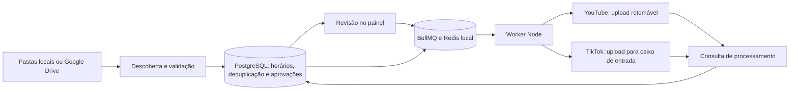

# Motor local de publicação

Implementação em Node.js/TypeScript com BullMQ, Redis e PostgreSQL. Substitui a dependência do Postiz para as rotinas locais, a revisão e a integração direta com as plataformas. A opção Postiz continua disponível para preservar instalações e históricos anteriores.

## Arquitetura

- `src/scheduler.ts`: Job Scheduler BullMQ a cada 10 segundos na fila de coordenação, com concorrência global um. A fila separada de transferências tem concorrência global dois, inclusive com vários processos. Trabalhos `publish` antigos são encaminhados automaticamente para essa fila.
- `src/worker.ts`: descoberta, verificação de arquivos estáveis e seleção das oportunidades de envio. As rotinas existentes de leitura local e Drive são compartilhadas.
- `src/local-publisher.ts`: preparação, cópias persistentes, aprovações, claims de conteúdo, tentativas e reconciliação.
- `src/native-auth.ts` e `src/native-routes.ts`: OAuth separado por plataforma, verificação de permissões, contas, configurações e ações do painel.
- `src/native-api.ts`: protocolos oficiais de transferência e consulta de status.

O PostgreSQL é a fonte do estado de negócio. O Redis contém os trabalhos do scheduler e publicações, com AOF e `noeviction`. Jobs carregam somente o ID da entrega; tokens, URLs de upload e segredos não são enviados ao Redis. Sessões e tokens são cifrados no PostgreSQL com AES-256-GCM.

Uploads usam advisory locks por conta e por entrega: contas distintas podem transferir em paralelo, enquanto a mesma conta mantém um envio por vez. A recuperação só retoma entregas cujo lock está livre. O coordenador continua executando durante essas transferências. Descoberta e preparação de mídia ainda são sequenciais no coordenador; downloads de origem demorados podem alongar esse ciclo.

Os horários são calculados em `America/Sao_Paulo`. Uma rotina escolhe um vídeo por oportunidade; há intervalos ou horários fixos, com padrão 08:00 e 20:00 para o modo diário. Um upload automático pendente impede preparar outro automático na mesma rotina; após a confirmação, o próximo horário é recalculado. Vídeos aprovados manualmente entram na fila assim que o usuário confirma, respeitando a pausa global e a pausa da rotina.

## Estados e revisão

Uma entrega nova fica em `review`, salvo no YouTube automático quando a rotina e a configuração da conta autorizam o envio; nesse caso, fica em `pending`. O TikTok sempre começa em `review`.

| Estado | Significado |
| --- | --- |
| `review` | Cópia no computador, aguardando revisão e consentimento |
| `pending` / `retry` | Envio autorizado, aguardando execução ou nova tentativa segura |
| `submitting` | Worker transferindo o arquivo na sessão persistida |
| `processing` | Plataforma confirmou a transferência; processando o vídeo |
| `private` / `unlisted` / `published` | Estado retornado pelo YouTube |
| `inbox` | TikTok enviou a notificação para concluir a edição/publicação |
| `completed` | TikTok informou `PUBLISH_COMPLETE`; não comprova audiência pública |
| `unknown` | Resultado ambíguo; exige consulta/reconciliação antes de outra tentativa |
| `failed` | Falha confirmada; histórico informa o problema |
| `duplicate` | Conteúdo idêntico já reivindicado para o mesmo canal |
| `cancelled` | Revisão/entrega descartada antes de abrir sessão externa |

Na revisão, o painel mostra a conta de destino, a prévia, título, legenda e hashtags. Para YouTube também mostra visibilidade, conteúdo para crianças e mídia alterada/IA. O usuário precisa confirmar o envio. No TikTok, a tela informa que o upload vai à caixa de entrada, e que legenda, rotulagem e publicação precisam ser finalizadas no aplicativo.

As cópias de revisão ficam no volume `spool`, com um arquivo por destino. São removidas após confirmação do upload ou descarte antes da sessão externa. Conteúdo aguardando revisão ocupa disco; a origem local/Drive não é alterada. A limpeza de metadados é compartilhada com o fluxo anterior e preserva as declarações do JSON.

Se outro destino já mantém uma cópia preparada do mesmo vídeo e da mesma opção de limpeza, o motor confere o hash dessa cópia e as versões do vídeo/JSON na origem antes de reaproveitá-la. Isso evita outro download e outra limpeza. Cada destino continua com seu arquivo e claim; excluir um não exclui o outro. Cópias ausentes ou alteradas provocam preparação pela origem. O sistema tenta cópia com CoW quando suportado pelo volume, com fallback automático para cópia comum. Não retém arquivos extras como cache após o descarte das entregas.

## Protocolos oficiais

A limpeza das tags do MP4 e a declaração `containsSyntheticMedia` enviada ao YouTube são independentes. O arquivo pode estar limpo e, ainda assim, receber o rótulo porque a declaração foi ativada. Nos perfis de conteúdo, a opção do YouTube é separada da declaração do TikTok; deve refletir o conteúdo real de cada origem. A gravação normal de gameplay, por si só, não exige a declaração do YouTube. [Orientação oficial](https://support.google.com/youtube/answer/14328491?hl=pt-BR).

O helper de manutenção `updateYoutubeDisclosure` verifica o dono do vídeo, atualiza somente `part=status`, preserva privacidade, agendamento, licença, incorporação, estatísticas e público infantil, e recusa uma data vencida. Algumas respostas da API omitem `containsSyntheticMedia`; nesse caso o retorno distingue o pedido aceito da leitura da propriedade. Confirme o rótulo na interface do YouTube.

### YouTube

- OAuth Web com PKCE, state de uso único, cookie HttpOnly e permissões `youtube.upload` e `youtube.readonly`.
- `GET /youtube/v3/channels?part=snippet&mine=true` identifica o canal durante a conexão.
- `POST /upload/youtube/v3/videos?uploadType=resumable&part=snippet,status` cria uma sessão; sua URL é persistida antes de enviar os bytes.
- `PUT` em blocos de 8 MiB, com `Content-Range`; uma consulta vazia à mesma sessão determina os bytes aceitos ou recupera o ID de um vídeo já criado.
- Respostas HTTP 308 do protocolo retomável são lidas como progresso, com ou sem `Location`. O cliente não segue redirecionamentos nem encaminha as credenciais para outro endereço; demais respostas 3xx são recusadas.
- `GET /youtube/v3/videos?part=snippet,status,processingDetails&id=...` acompanha processamento e visibilidade.
- No modo de envio por oportunidade, o scheduler local determina quando iniciar o upload. No agendamento nativo e nos pedidos finitos, usa `publishAt` com privacidade privada até a data reservada; depois da confirmação, a plataforma controla a publicação.
- `privacyStatus` é sempre explícito, com padrão privado. `containsSyntheticMedia` e `selfDeclaredMadeForKids` vêm dos metadados aprovados.

Sessão expirada depois de um resultado incerto entra em `unknown`. O motor não abre outra sessão automaticamente. O painel permite vincular o ID de um vídeo existente; a API confere se ele pertence ao canal conectado.

[Documentação de upload](https://developers.google.com/youtube/data/reference/rest/v3/videos/insert), [protocolo retomável](https://developers.google.com/youtube/data/guides/using_resumable_upload_protocol).

### TikTok

- Login Kit Desktop para localhost/127.0.0.1 com porta, ou Login Kit Web para callback HTTPS em domínio público; ambos usam state de uso único. O tipo é escolhido em Conexões e precisa corresponder ao cadastro no portal. Configurações antigas preservam Web; novas configurações locais preferem Desktop.
- No Desktop, um verificador aleatório é cifrado no estado OAuth e o desafio usa SHA-256 em hexadecimal, conforme o contrato TikTok. O callback exige o cookie, o state válido e o mesmo tipo de login, e envia o verificador na troca do código. [Contrato Desktop](https://developers.tiktok.com/docs/en/login-kit-desktop).
- A conexão verifica `user.info.basic`, `video.upload`, identidade e tokens com expiração. Refreshes são serializados para persistir o token de renovação rotacionado.
- `POST /v2/post/publish/inbox/video/init/` com `FILE_UPLOAD` cria a sessão de caixa de entrada.
- Upload sequencial em blocos conforme a regra de arredondamento para baixo: o último bloco absorve o restante. Não exige URL pública dos vídeos.
- `POST /v2/post/publish/status/fetch/` consulta os bytes recebidos e a conclusão do envio. Uma retomada utiliza o mesmo `publish_id`.
- O endpoint de caixa de entrada não publica a legenda automaticamente; o texto e a indicação de IA ficam disponíveis no painel para a edição final no TikTok.

O motor não chama Direct Post. A documentação dessa API rejeita ferramentas privadas limitadas ao próprio usuário/equipe, além de exigir auditoria e UX específica. `video.upload` também depende de aprovação do aplicativo e consentimento real do usuário. A instalação não presume essas permissões a partir de Client Key/Secret.

[Upload para revisão](https://developers.tiktok.com/docs/en/content-posting-api-get-started-upload-content), [transferência em blocos](https://developers.tiktok.com/docs/en/content-posting-api-media-transfer-guide), [consulta](https://developers.tiktok.com/docs/en/content-posting-api-reference-get-video-status), [regras de Direct Post](https://developers.tiktok.com/docs/en/content-sharing-guidelines), [Login Kit Web](https://developers.tiktok.com/docs/en/login-kit-web).

## Recuperação e compatibilidade

- A migração adiciona campos às entregas existentes. O histórico anterior recebe `engine=postiz`; os novos envios locais recebem `engine=local`.
- O modo padrão é `local`. Alterar o motor não troca os canais das rotinas automaticamente. A seleção deve corresponder ao motor ativo.
- No reinício, uma entrega local interrompida volta à fila. A sessão é consultada antes de transferir mais bytes. No Postiz, um pedido de criação interrompido continua sem retry cego.
- Erros temporários usam backoff e respeitam `Retry-After`, com até cinco tentativas. Resultados ambíguos bloqueiam uma criação nova. Uma confirmação já gravada impede reenvio mesmo se uma limpeza posterior falhar.
- SHA-256 é calculado sobre os bytes originais. Drive e disco compartilham os claims quando o canal do motor é o mesmo. IDs locais e Postiz são diferentes; históricos de motores distintos não têm deduplicação automática cruzada.
- A fila é reconstruída a partir das entregas pendentes a cada ciclo. Se o Redis for substituído ou esvaziado, reinicie o serviço para recriar o Job Scheduler; banco e volume de mídia precisam ser preservados.

## Validação e limites

Os testes usam PostgreSQL/Redis reais, MP4s com FFmpeg e respostas simuladas das plataformas. Verificam upload em blocos, resposta final perdida, retomada sem duplicar, sessões expiradas, escopos ausentes, conta trocada, consentimento, pausa, deduplicação, refresh rotacionado e scheduler persistido com múltiplos consumidores.

A integração real depende das credenciais OAuth e da autorização das contas do usuário. Nenhuma conta foi conectada nem publicação real realizada pelos testes. Múltiplas contas YouTube/TikTok OAuth são preservadas separadamente. Os pedidos TikTok usam perfis isolados do Chrome. Veja [Pedidos e contas](ASSISTENTE-E-CONTAS.md). O modo TikTok Desktop funciona com callback HTTP em localhost e porta. O modo Web exige HTTPS e configuração externa protegida; o painel padrão permanece acessível apenas no localhost. A existência de PKCE ou de HTTPS não substitui a aprovação dos escopos.
